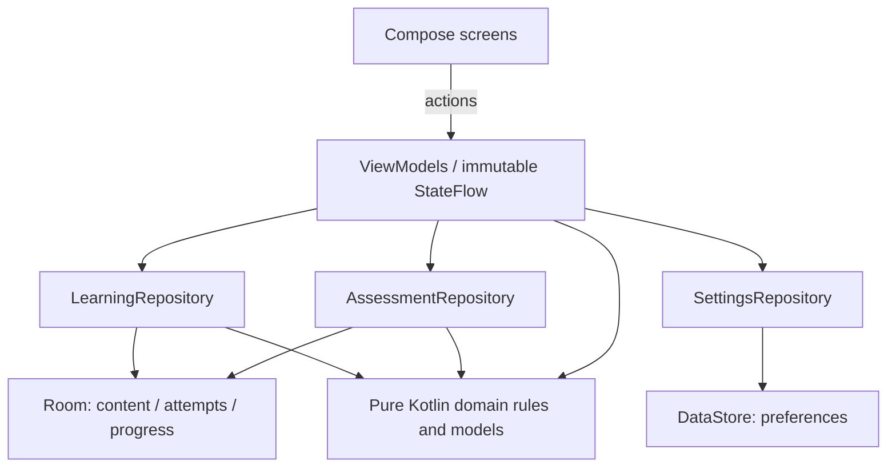

# Architecture review — 8 October 2026

Originally reviewed application commit `eb3ae63` (v0.15.0). The audit added repeatable architecture checks, adversarial probes and this report without changing application behaviour. The subsequent v0.16.0 correction is recorded below; original failing results remain as historical evidence.

**Assessment:** the package boundaries and persistence approach are a reasonable MVP foundation. The two reproduced functional defects (A1/A2) have been corrected in v0.16.0. A3–A5 remain documented growth risks and future design choices; the audit did not establish a current latency failure or a need for a framework rewrite.

## Corrections in v0.16.0

- **A1 resolved:** one Room invalidation stream triggers a transaction that captures topics, questions, progress and attempts together. JSON decoding happens after the transaction, off the main thread. The separate table query flows were removed. No database schema or stored learning records change.
- **A2 resolved:** topic practice passes a separate `topicId` argument. The ViewModel resolves a typed daily/review/topic/assessment request, preserving legacy saved arguments and pinned queues. Content IDs such as `review`, `all`, `assessment` and `topic` remain valid.
- The original emission probes are now permanent [architecture regressions](../app/src/androidTest/java/fi/kansalaisuuskoe/ArchitectureRegressionTest.kt). They also require observing the final write, preventing a silent/non-updating stream from passing. Extra tests cover an empty database, both colliding names, an ordinary imported name and saved-queue recovery.
- [Real navigation regressions](../app/src/androidTest/java/fi/kansalaisuuskoe/TopicRoutingFlowTest.kt) open lessons for `review` and `all`, recreate the Activity and complete only that topic's questions. Pure JVM request tests retain daily/review/assessment and legacy routing semantics.

Current verification is recorded in [VERIFICATION-0.16.0.md](VERIFICATION-0.16.0.md). The findings and counts below describe the original v0.15 audit unless explicitly stated otherwise.

## Structure and strengths

One Android application module; 39 production Kotlin files: six domain, seven data, 24 UI and two application/bootstrap files. Manual constructor injection creates one Room database and repositories in `AppContainer`.



- Domain code imports only Kotlin/JVM standard APIs. It has no Android, Compose, Room, JSON or data/UI dependencies. Learning rules accept explicit time, and assessment queue selection accepts randomness.
- UI receives reactive state and invokes ViewModel actions. Lifecycle-aware collection is used. ViewModels do not hold Activity, Context, Compose or navigation dependencies. Screens do not access Room entities/DAOs or DataStore directly; document-picker plumbing remains in UI.
- Answer/history/progress writes, imports, restores and assessment edits are transactionally protected. Idempotent answer tokens, versioned questions, historical language ownership and stale-preview checks address real failure modes.
- Persisted question content is replaceable independently of screens. Native lesson versions and optional supporting translations are separate from scored question attempts. Assessment snapshots preserve original results after updates without copying every reading lesson.
- All six Room schemas are exported and migrations 1→6 are registered. No destructive-migration fallback, main-thread query allowance, production `runBlocking`, or `GlobalScope` was found.
- Manual injection and one module remain reasonable here. This audit provides no evidence that Hilt, generic use-case wrappers or a broad module rewrite would solve the defects below.

These choices broadly follow [Android architecture recommendations](https://developer.android.com/topic/architecture/recommendations). Those recommendations allow adaptation to application size; this is a design judgment, not a formal Android certification.

## Findings

### A1 — P2: observers can receive inconsistent learning snapshots — resolved

**Verified on the emulator.** `LearningRepository.kt:13` combines four independent Room query flows for topics, questions, progress and attempts. Writes commit atomically, but query emissions are separate. `combine` takes the latest value from each flow; it does not turn them into a shared database read transaction. This behaviour is consistent with the [coroutines combine contract](https://kotlinlang.org/api/kotlinx.coroutines/kotlinx-coroutines-core/kotlinx.coroutines.flow/combine.html).

Two probes assert invariants on every observed emission, rather than checking only `snapshot.first()` after a write:

1. Forty normal answer writes produced **21 inconsistent emissions**. Examples included history count 0 with progress count 1, and history count 5 with progress count 4.
2. Thirty versioned full-content imports produced **21 inconsistent emissions**. For example, questions referred to `round-3-democracy` while the visible topic list belonged to round 4.

This is an observable-state defect; the probes do not establish durable database corruption. Dashboard counts and topic labels can briefly disagree. A queue opened from an intermediate snapshot can capture mismatched content. That possible queue impact is an inference from the consumer code, not a separately reproduced navigation failure.

**Recommended correction:** expose one coherent repository snapshot. Observe invalidation of the relevant tables, read all required tables within one Room transaction, then map the captured rows outside that transaction. Alternatively use a transactional DAO projection. Do not patch this with an arbitrary debounce delay. Move both emission-invariant probes into the normal Android suite after fixing it.

### A2 — P2: valid imported topic IDs collide with practice commands — resolved

**Verified on the emulator.** `Content.kt:69` accepts topic IDs such as `review` and `all`. `CitizenshipApp.kt:93` navigates topic practice through `study/$topicId`, while `QuestionViewModel.kt:48–53` interprets the same parameter as a command.

The probe imported a valid topic named `review` with five unseen Finnish questions. Opening its practice mode produced **zero questions**, because the ViewModel selected the due-review queue. `all` also shares the daily-plan command namespace; its incorrect scope follows from the code, but only the `review` collision was executed in this audit.

**Recommended correction:** give practice kind and topic ID separate arguments/routes, with an explicit request type in the ViewModel. Keep content IDs independent of navigation commands. Add regression cases for both names and ordinary imported IDs.

### A3 — P2: full-history observation and UI calculation need a growth plan

**Source-verified design risk; latency was not benchmarked.** The shared repository stream loads every attempt (`LearningDatabase.kt:48`) and maps the complete snapshot again after relevant changes (`LearningRepository.kt:13`). Each collector gets a cold stream. `AppUiState.studySnapshot` and `summary` (`AppViewModel.kt:22–23`) filter history and calculate summaries in getters used by Compose; Topics calls the summary getter more than once. The UI clock triggers another state update every 30 seconds.

Small demo data does not prove this remains responsive with years of study history. Assessment observation similarly decodes all saved question snapshots, including when a detail screen needs one session.

**Recommended correction:** compute dashboard projections once off the main thread; expose only required aggregates and recent history to screens. Cache/share immutable installed content, and query assessment detail by ID. Measure with representative content and 10,000–50,000 attempts before introducing paging or further storage abstractions.

### A4 — P3: backup export limits do not match unrestricted local growth

**Source-verified boundary mismatch.** Backup validation caps history at 50,000 answers, 1,000 assessments and 16 MiB. Local answer/assessment storage has no matching retention or export-partition policy. The same validator is used for export, so a sufficiently large valid local history becomes unexportable. This audit did not fill a physical device to those limits; the rejection follows directly from `BackupCodec.encode/validate` and the repository's unbounded export lists.

**Recommended correction:** define lossless export beyond those limits, or provide explicit user-controlled archival with advance notice. Keep bounded import parsing. Do not silently delete old attempts to satisfy the export cap.

### A5 — P3: reuse and fast ViewModel testing have practical limits

**Verified structure; future design choice.** The domain is Android-independent, but uses `java.time`, `java.text.Normalizer` and `java.util.Locale`; it is currently JVM Kotlin, not a compiled Kotlin Multiplatform library. Repository construction depends on Room/Android, and ViewModels accept concrete repositories. Existing ViewModel coverage primarily uses instrumented device tests rather than a fast JVM fake-repository suite.

No immediate rewrite is warranted. When JVM ViewModel tests or iOS work become active requirements, add small repository contracts at those boundaries and replace JVM-specific APIs as needed. Extract a domain module then to obtain compiler-enforced boundaries. The new checks provide source-level protection meanwhile.

## Verification and reproducibility

`scripts/verify-architecture.py` adds eight checks (seven architecture contracts plus a literal/comment-filter sanity check) and is included in `scripts/verify.ps1`. It checks dependency directions, UI storage access, ViewModel platform independence, private mutable StateFlows, unsafe escape hatches and registered/exported migrations. These are deliberately small source-level checks; they do not replace the Kotlin compiler, detect every fully qualified dependency, or prove runtime consistency.

An additional in-memory check deliberately introduced six forbidden patterns: an Android domain import, a data→UI dependency, direct Room access from UI, Context in a ViewModel, public mutable state, and blocking UI code. All six were rejected by the relevant contract. Production source files were not changed for these checks.

The original red run is retained in a portable [result record](architecture-probes/results-2026-10-08.json). The probes were promoted into the normal `androidTest` suite, linked above. They use disposable databases and synthetic test imports, without changing bundled content.

```powershell
$env:JAVA_HOME = 'C:\Program Files\Android\Android Studio\jbr'
python .\scripts\verify-architecture.py
.\scripts\run-architecture-probes.ps1 -Offline
.\scripts\verify.ps1 -Offline
```

Use the dedicated project emulator for connected checks; set `ANDROID_SERIAL` when other devices are connected. The focused runner now selects the permanent regression classes and saves logs/XML under `.verification/architecture`, without copying or deleting test sources. It must pass on v0.16.0. On the originally reviewed v0.15 application, **all three original probes failed**, exposing A1 and A2; the old normal suite did not cover these invariants.

Host verification of the original v0.15 application (before the v0.16.0 corrections) reran all tasks (114 executed), including JVM tests, both lint variants, debug/release APK assembly and the unsigned release bundle. The final complete `verify.ps1 -Offline` run passed after emulator recovery:

| Check (v0.15 audit run; v0.16.0 counts are in VERIFICATION-0.16.0.md) | Result |
|---|---|
| Architecture contracts | 8 passed; six additional in-memory forbidden changes rejected |
| JVM tests | 153 passed; no failures, errors or skips |
| Normal Android device tests | 133 passed; no failures, errors or skips |
| Python content-gate tests | 9 passed |
| Source/resources | 89 files checked; 301 Finnish/English resources aligned |
| Debug/release lint | No errors; existing `OldTargetApi` and debug `AndroidGradlePluginVersion` warnings |
| Debug APK / minified unsigned release APK / unsigned AAB | Built successfully |
| Additional runtime architecture probes | **3 failed**, exposing A1 and A2; no errors or skips |

The first normal run executed 133 device tests with two failures: the system document-picker focus check and the native accessibility home action. A targeted retry also timed out in the picker. Native inspection then captured an Android **System UI isn't responding** dialog (`.verification/architecture-after-navigation-failure.png`), with `com.android.systemui` as the blocked window. The dedicated emulator was rebooted before repeating the normal suite; no application or existing test assertions were changed to bypass those failures. Initial XML is retained at `.verification/architecture/normal-suite-first.xml`.

After reboot the full 133-test run passed, including both affected checks. Final normal XML is retained at `.verification/architecture/normal-suite-final.xml`; the separate failing architecture XML/log remain in the same directory. The portable result record includes both outcomes. No performance conclusion is drawn from these pass counts.

## Scope limits and decision

This is a source review, boundary check and targeted runtime audit on Android 16/API 36. No production features, official-content claims, publishing, remote repository, human content review or learner evaluation were introduced. No physical-device performance benchmark, iOS compilation, large-history latency benchmark, or exhaustive concurrency proof was performed. Source checking remains separate from human editorial approval.

A1 and A2 are corrected and their regressions are part of the regular gate. Next measure projection cost and define a backup growth policy. Continue with the existing architecture; these findings call for focused corrections rather than a new framework.
